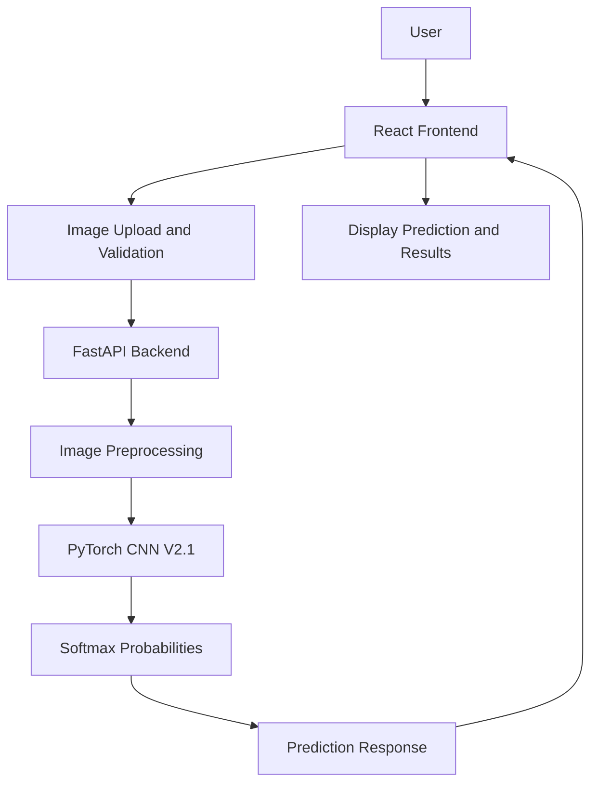

# MedVision — End-to-End Deep Learning Medical Image Classification

**MedVision** is an end-to-end deep learning application that classifies histopathological images into nine tissue categories using a Convolutional Neural Network (CNN).

The project combines **PyTorch, FastAPI, React, and TypeScript** to demonstrate the development of a complete machine learning application, from dataset exploration and model training to backend API development and an interactive frontend.

MedVision is developed as an educational and portfolio project to explore deep learning, computer vision, model evaluation, and full-stack machine learning deployment.

> **Disclaimer:** MedVision is an educational and research prototype. It is not clinically validated and must not be used for medical diagnosis, treatment decisions, or other clinical purposes. Model probabilities are not medically calibrated confidence scores.

---

## 1. Project Overview

### Objectives

The primary objectives of MedVision are:

- Develop a CNN-based medical image classification model using PyTorch.
- Explore and preprocess the PathMNIST dataset.
- Build and compare multiple CNN architectures.
- Evaluate model performance using accuracy, precision, recall, and F1-score.
- Develop a REST API using FastAPI to serve model predictions.
- Create an interactive frontend using React and TypeScript.
- Integrate the frontend and backend into a functional machine learning application.
- Implement image validation, error handling, and API health monitoring.

### Key Features

- **Nine-class classification:** Identifies nine different tissue categories.
- **Image upload:** Supports PNG and JPEG images.
- **Image preview:** Displays uploaded images and image information.
- **Real-time inference:** Sends images to the trained CNN through a FastAPI backend.
- **Prediction probabilities:** Displays the predicted category and probability distribution across all nine categories.
- **Top-three predictions:** Highlights the three highest-scoring categories.
- **API monitoring:** Displays whether the backend is online and whether the model is loaded.
- **Input validation:** Rejects unsupported file formats, invalid images, and oversized uploads.
- **Responsive interface:** Provides a dashboard that adapts to different screen sizes.

---

## 2. Technologies Used

| Category | Technologies |
|---|---|
| Programming languages | Python, TypeScript, JavaScript |
| Machine Learning | PyTorch |
| Dataset | PathMNIST (MedMNIST) |
| Image Processing | Pillow, NumPy |
| Backend | FastAPI, Uvicorn |
| Frontend | React, Vite |
| Styling | Tailwind CSS v4 |
| Testing | Pytest, HTTPX |
| Development tools | VS Code, Git, GitHub |
| Hardware acceleration | Apple Metal Performance Shaders (MPS) |

### Technology Overview

**PyTorch**

Used to implement, train, validate, and evaluate the convolutional neural networks.

**FastAPI**

Provides REST API endpoints for model health monitoring and image classification.

**React and TypeScript**

Power the interactive frontend, including image uploading, previewing, prediction results, and API status monitoring.

**Tailwind CSS**

Provides responsive styling and the dashboard interface.

---

## 3. Dataset

### PathMNIST

MedVision uses the PathMNIST dataset from the MedMNIST collection.

PathMNIST contains histopathological images of colorectal tissue divided into nine tissue categories.

The original dataset provides small RGB images with dimensions of 28 × 28 pixels.

### Dataset Distribution

| Dataset Split | Number of Images |
|---|---:|
| Training | 89,996 |
| Validation | 10,004 |
| Testing | 7,180 |
| **Total** | **107,180** |

### Classification Categories

The model identifies the following nine categories:

| Class ID | Tissue Category |
|---:|---|
| 0 | Adipose |
| 1 | Background |
| 2 | Debris |
| 3 | Lymphocytes |
| 4 | Mucus |
| 5 | Smooth Muscle |
| 6 | Normal Colon Mucosa |
| 7 | Cancer-associated Stroma |
| 8 | Colorectal Adenocarcinoma Epithelium |

### Preprocessing

The preprocessing pipeline includes:

1. Loading images from the PathMNIST dataset.
2. Converting images into numerical arrays.
3. Converting image dimensions from NHWC to NCHW format.
4. Normalizing pixel values from the range 0–255 to 0–1.
5. Converting images into PyTorch tensors.
6. Creating DataLoaders for training, validation, and testing.

The training DataLoader uses a batch size of 64.

### Data Augmentation

Data augmentation is applied to the training dataset to improve model generalization.

The augmentation techniques include:

- Random horizontal flipping.
- Random vertical flipping.
- Random right-angle rotation.

Augmentation is applied to training data only.

Class weighting is also used during training to address differences in class frequencies.

---

## 4. Model Development

MedVision was developed through multiple CNN experiments.

### Baseline CNN

The first model established a baseline for classification performance.

- Architecture: Custom Convolutional Neural Network.
- Parameters: 422,089.
- Training duration: 5 epochs.
- Best validation macro F1-score: 0.8172.

The baseline model provided a reference point for subsequent architectural improvements.

### Improved CNN — V2

The second model introduced a more compact architecture.

Key improvements included:

- Three convolutional blocks.
- Batch normalization.
- Adaptive average pooling.
- Dropout regularization.
- Class-weighted training.
- Training data augmentation.

The V2 architecture contains 111,369 trainable parameters.

The model achieved a validation macro F1-score of 0.8991.

### Improved CNN — V2.1

V2.1 retained the improved CNN architecture while experimenting with a lower learning rate.

- Architecture: MedVisionCNNV2.
- Learning rate: 0.0003.
- Parameters: 111,369.
- Best validation macro F1-score: 0.9052.

The V2.1 checkpoint is:

`models/medvision_cnn_v2_lr0003.pth`

This checkpoint is used by the FastAPI backend for inference.

### Model Architecture

The overall architecture follows this pipeline:

1. Input RGB image.
2. Convolutional feature extraction.
3. Batch normalization and activation.
4. Additional convolutional feature extraction blocks.
5. Adaptive average pooling.
6. Dropout regularization.
7. Classification output for nine categories.

The final output is converted into a probability distribution using Softmax.

---

## 5. Model Evaluation

The models were evaluated using:

- Accuracy
- Precision
- Recall
- Macro F1-score
- Weighted F1-score
- Confusion matrices
- Per-class classification reports

### Validation Performance

| Model | Parameters | Validation Macro F1 |
|---|---:|---:|
| Baseline CNN | 422,089 | 0.8172 |
| Improved CNN V2 | 111,369 | 0.8991 |
| Improved CNN V2.1 | 111,369 | **0.9052** |

### Test Performance

The final test evaluation produced the following results:

| Metric | Baseline CNN | Improved CNN V2.1 |
|---|---:|---:|
| Accuracy | 0.8006 | 0.7710 |
| Macro F1-score | 0.7354 | 0.7334 |
| Weighted F1-score | 0.8021 | 0.7793 |

### Evaluation Discussion

The improved CNN V2.1 achieved the strongest validation macro F1-score, increasing from 0.8172 for the baseline to 0.9052.

However, the independent test evaluation showed a different result.

The baseline model achieved a slightly higher test accuracy and macro F1-score than V2.1.

This difference highlights an important machine learning consideration: strong validation performance does not necessarily guarantee better performance on unseen test data.

The test dataset also comes from a different source than the training and validation datasets, which may contribute to differences in performance.

The results therefore require careful interpretation and should not be treated as evidence of clinical reliability.

### Important Evaluation Principle

The test dataset was used for final model evaluation rather than repeated model tuning.

Validation performance was used to monitor training and compare model configurations.

Detailed evaluation results, confusion matrices, classification reports, and learning curves are available in the `docs/` directory.

---

## 6. System Architecture

MedVision uses a three-part architecture:

- Frontend: React and TypeScript.
- Backend: FastAPI and Python.
- Machine learning model: PyTorch CNN.

### Architecture Diagram



### Prediction Workflow

1. The user uploads a PNG or JPEG image.
2. The frontend validates the file format and size.
3. The frontend sends the image to the backend through the `/predict` endpoint.
4. FastAPI receives the uploaded image.
5. Pillow converts the image into RGB format.
6. The image is resized to 28 × 28 pixels.
7. Pixel values are normalized and converted into a PyTorch tensor.
8. The trained CNN generates classification scores.
9. Softmax converts the scores into probabilities.
10. The backend returns the predicted class and probability distribution.
11. The frontend displays the classification results.

---

## 7. Backend API Documentation

The backend is implemented using FastAPI.

### Available Endpoints

| Method | Endpoint | Description |
|---|---|---|
| GET | `/` | Returns basic API information. |
| GET | `/health` | Checks backend and model status. |
| POST | `/predict` | Performs image classification. |

### Health Check

**Request**

`GET /health`

Example response:

```json
{
  "status": "healthy",
  "model_loaded": true,
  "device": "mps:0"
}
```

The device may differ depending on the available hardware.

### Image Prediction

**Request**

`POST /predict`

Content type:

`multipart/form-data`

Parameter:

- `file`: Image file in PNG or JPEG format.

Example response:

```json
{
  "filename": "sample_pathmnist.png",
  "predicted_class": "Adipose",
  "predicted_index": 0,
  "probabilities": {
    "Adipose": 0.92,
    "Background": 0.02,
    "Debris": 0.01,
    "Lymphocytes": 0.01,
    "Mucus": 0.01,
    "Smooth Muscle": 0.01,
    "Normal Colon Mucosa": 0.01,
    "Cancer-associated Stroma": 0.005,
    "Colorectal Adenocarcinoma Epithelium": 0.005
  },
  "disclaimer": "For educational and research purposes only. Not for medical diagnosis."
}
```

*The probability values above are illustrative and do not represent a recorded prediction.*

### API Validation and Error Handling

The backend includes:

- Maximum upload size of 10 MB.
- Invalid image detection.
- Unsupported image validation.
- HTTP 400 responses for invalid image content.
- HTTP 413 responses for oversized uploads.
- CORS configuration for the local frontend.

### Interactive API Documentation

FastAPI automatically generates interactive API documentation.

Once the backend is running, visit:

`http://127.0.0.1:8000/docs`

---

## 8. Frontend

The frontend is built with React and TypeScript using Vite.

### Main Features

**Image Upload**

- Select PNG and JPEG images.
- Drag and drop images.
- Preview selected images.
- Replace or remove selected images.

**Image Information**

Displays:

- Filename.
- Image dimensions.
- File size.
- Image format.

**Prediction Results**

Displays:

- Predicted tissue category.
- Prediction probability.
- Top-three predictions.
- Probability distribution across all nine categories.

**Backend Status**

The interface checks backend availability and model loading status.

It displays whether the backend is online or offline.

**Responsive Design**

The dashboard adapts to different screen widths, with content panels and metric cards rearranging for smaller screens.

**Error Handling**

The frontend handles:

- Unsupported file formats.
- Oversized files.
- Invalid or corrupted images.
- Backend connection failures.
- Failed prediction requests.

---

## 9. Installation and Setup

### Prerequisites

Before running MedVision, install:

- Python 3.12 or compatible version.
- Node.js and npm.
- Git.
- A code editor such as Visual Studio Code.

The project was developed and tested on macOS using Apple MPS acceleration.

CPU inference is also supported.

### Step 1 — Clone the Repository

```bash
git clone https://github.com/KeonhoWang/MedVision.git

cd MedVision
```

### Step 2 — Create a Python Virtual Environment

```bash
python3 -m venv .venv
```

Activate it:

```bash
source .venv/bin/activate
```

### Step 3 — Install Backend Dependencies

```bash
pip install --upgrade pip

pip install -r backend/requirements.txt
```

### Step 4 — Prepare the Dataset and Model Checkpoint

The dataset and trained model weights are intentionally excluded from GitHub to avoid uploading large binary files.

Prepare the PathMNIST dataset using the notebooks in the `notebooks/` directory.

Recreate or train the final model and place the V2.1 checkpoint at:

```text
models/medvision_cnn_v2_lr0003.pth
```

The backend expects this checkpoint when loading the model.

### Step 5 — Start the Backend

From the project root:

```bash
uvicorn backend.main:app --reload
```

The backend will be available at:

`http://127.0.0.1:8000`

API documentation:

`http://127.0.0.1:8000/docs`

### Step 6 — Install Frontend Dependencies

Open a second terminal.

Navigate to the frontend directory:

```bash
cd frontend
```

Install dependencies:

```bash
npm install
```

### Step 7 — Start the Frontend

```bash
npm run dev
```

The frontend will usually be available at:

`http://localhost:5173`

Keep both the backend and frontend terminals running while using the application.

---

## 10. Running Tests

MedVision includes automated API tests using Pytest and HTTPX.

The test suite covers:

1. Root endpoint availability.
2. Backend health endpoint.
3. Successful image prediction.
4. Invalid image rejection.
5. Oversized image rejection.

From the project root, activate the virtual environment and run:

```bash
python -m pytest tests/test_api.py -v
```

### Test Results

The API test suite has passed all five tests:

```text
5 passed, 1 warning
```

The warning concerns a Starlette testing dependency deprecation notice and did not cause test failures.

---

## 11. Project Structure

```text
MedVision/
│
├── backend/
│   ├── __init__.py
│   ├── main.py
│   ├── model.py
│   ├── predictor.py
│   ├── requirements.txt
│   └── test_predictor.py
│
├── data/
│   └── medmnist/
│
├── docs/
│   ├── DATASET_ANALYSIS.md
│   ├── PROJECT_LOG.md
│   ├── RESULTS.md
│   ├── final_model_comparison.csv
│   └── figures/
│
├── frontend/
│   ├── public/
│   ├── src/
│   │   ├── assets/
│   │   ├── App.tsx
│   │   ├── App.css
│   │   ├── index.css
│   │   └── main.tsx
│   ├── package.json
│   └── vite.config.ts
│
├── models/
│   └── medvision_cnn_v2_lr0003.pth
│
├── notebooks/
│   ├── 01_dataset_exploration.ipynb
│   ├── 02_data_preprocessing.ipynb
│   ├── 03_building_cnn.ipynb
│   └── 04_improved_cnn.ipynb
│
├── src/
│   └── check_environment.py
│
├── tests/
│   └── test_api.py
│
├── .gitignore
└── sample_pathmnist.png
```

**Note:** The `data/` and `models/` directories are local project directories. They are excluded from the GitHub repository and must be prepared locally before running the application.

---

## 12. Limitations and Future Improvements

### Current Limitations

**Dataset Resolution**

PathMNIST images are only 28 × 28 pixels. This limits the amount of fine-grained visual information available to the model.

**Generalization**

The test evaluation indicates that validation performance does not necessarily translate into equivalent performance on unseen data.

The difference in dataset sources may also contribute to distribution shift.

**Model Calibration**

Softmax probabilities represent the model's output distribution. They are not calibrated probabilities of clinical correctness.

**Clinical Reliability**

The model has not undergone clinical validation, external clinical testing, or regulatory approval.

It is not suitable for real-world medical decision-making.

**Model Distribution**

Trained weights and datasets are not included in the GitHub repository. Users must prepare these resources locally.

### Potential Future Improvements

- Evaluate higher-resolution histopathological images.
- Experiment with deeper CNN architectures and transfer learning.
- Investigate more robust data augmentation techniques.
- Improve generalization across different data sources.
- Perform external validation.
- Investigate model calibration and uncertainty estimation.
- Add prediction history and downloadable reports.
- Improve backend deployment and containerization using Docker.
- Expand automated testing and continuous integration.
- Improve application accessibility and frontend usability.

---

## 13. Repository

**GitHub:**  
https://github.com/KeonhoWang/MedVision

The repository contains the source code, notebooks, documentation, evaluation results, and frontend application.

---

## 14. Acknowledgements and References

This project uses the MedMNIST collection and its PathMNIST dataset.

- MedMNIST official website: https://medmnist.com/
- MedMNIST GitHub repository: https://github.com/MedMNIST/MedMNIST
- PyTorch documentation: https://pytorch.org/docs/
- FastAPI documentation: https://fastapi.tiangolo.com/
- React documentation: https://react.dev/
- Vite documentation: https://vite.dev/

The PathMNIST dataset is distributed under the CC BY 4.0 license. Refer to the original dataset documentation for attribution and usage requirements.

---

## 15. Author

**Keonho Wang**

Software Engineering Student  
Interested in Machine Learning, Artificial Intelligence, Computer Vision, and Full-Stack Development.

GitHub: https://github.com/KeonhoWang

LinkedIn: https://www.linkedin.com/in/keonho-wang-908a3b297/

**MedVision — An End-to-End Deep Learning Medical Image Classification System.**
